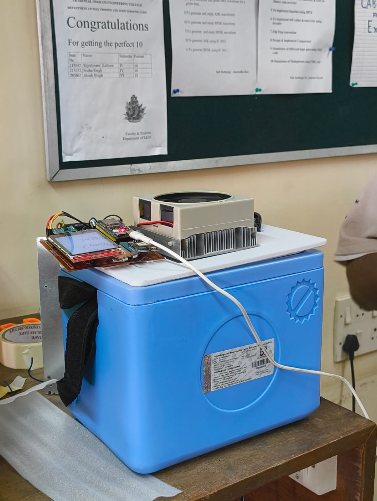

# VAXIQ

VAXIQ is a vaccine transport monitoring prototype built for Tech-A-Thon at Thadomal Shahani Engineering College. An ESP32-S3 collects temperature, load-cell inventory, and GPS readings, shows them on a local display, and records readings in Firebase Realtime Database. The enclosure photographed below carries the electronics and cooling assembly used for the hackathon demonstration.



## What the firmware does

| Part | Implementation |
| --- | --- |
| Temperature | A DS18B20 task reads and filters temperature measurements. |
| Inventory | An HX711 load-cell task estimates the number of vaccine units from measured weight. |
| Location | A GPS task parses coordinates and satellite information from UART data. |
| Display | An ILI9341 LCD with LVGL shows the latest temperature, unit count, and location. |
| Logging | A Firebase task waits for the sensor tasks, snapshots their shared data, and posts a history entry over HTTPS. |
| Thermal output | Fan speed is adjusted with PWM according to the temperature reading. The current integrated task does not implement closed-loop Peltier control. |
| Updates | A local HTTP page accepts an ESP32-S3 firmware image for an OTA update. |

The temperature, inventory, and GPS tasks use semaphores to coordinate each upload cycle. The Firebase task waits for their ready flags with timeouts, takes a mutex-protected snapshot, posts it, and then releases the sensors for the next cycle. This keeps values from different cycles from being mixed in one record.

## Code and branches

The integrated ESP-IDF firmware is in the [`Varun` branch](https://github.com/VarunAPatil/VAXIQ/tree/Varun/integration). Its main files are:

- `integration/main/main.c` — task creation and shared data setup.
- `integration/main/temp.c`, `load_cell.c`, and `gps_task.c` — sensor acquisition.
- `integration/main/lcd_task.c` — LVGL display.
- `integration/main/firebase_task.c` — upload and cycle coordination.
- `integration/main/peltier.c` — temperature-based fan PWM.
- `integration/main/ota_task.c` — Wi-Fi connection and OTA upload page.

The repository also includes separate sensor and display experiments used during integration. The default `main` branch provides the project overview; use `Varun` to inspect or build the integrated firmware.

## Building the integrated firmware

1. Install ESP-IDF and load its environment with `source /path/to/esp-idf/export.sh`.
2. Check the Wi-Fi settings in `integration/main/ota_task.h` and the Firebase endpoint in `integration/main/firebase_task.c`. Supply your own settings before running the firmware, and keep private credentials out of commits.
3. On the `Varun` branch, run:

   ```sh
   cd integration
   idf.py set-target esp32s3
   idf.py build
   ```

4. With the correct board and serial port connected, flash with `idf.py -p <PORT> flash monitor`.

This is a hackathon prototype. The repository documents the implementation; it does not establish calibrated temperature performance or medical storage compliance.
